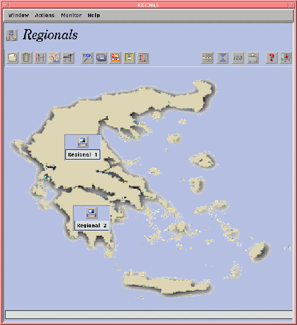

# Intracom Payphones (and Reverse Engineering)

Intracom is a Greek company, that produces a lot of telecommunication equipment, including payphones.

The purpose of this repository is to collect information about Intracom payphones, and to (attempt to) reverse engineer them, in order to understand how they work, and how to interface with them.

## Repository Structure

- `documents/` - marketing materials, product brochures, and other documents related to Intracom payphones.
- `documents/clippings/` - newspaper, website and magazine clippings about Intracom payphones.
- `documents/marketing/` - marketing materials and product brochures for Intracom payphones.
- `firmwares/` - firmware dumps from Intracom payphones, organized by version.
- `pictures/` - photographs and scans, including PCB images and archived screenshots of the management systems.
- `reverse_engineering/docs/` - protocol and settings documentation derived from the firmware.
- `tools/` - tools and scripts for analyzing Intracom payphone firmware and data.

## Payphone Models

Intracom's payphone range is built around the **INT** series of card-operated
public terminals, extended by the **MUST** series for ISDN. Every terminal is
supervised by the **CSMS** (Cardphone Supervision & Maintenance System) and is
usually paired with an exchange-side **Line Unit** that handles debiting and
anti-fraud detection.

### Cardphones

| Model | Type | Network | Dimensions (H x W x D) | Weight |
|---|---|---|---|---|
| **INT 100** | Indoor; table top or wall mounted | Analog (PSTN) | 75 x 189 x 220 mm | 1 kg (3 kg with inclined base) |
| **INT 200** | Outdoor, wall mounted, all weather | Analog (PSTN) | 275 x 275 x 172 mm | 6.5 kg |
| **INT 200 GSM** | Outdoor, wall mounted | GSM 900 / DCS 1800 | - | - |
| **MUST 400** | ISDN terminal | ISDN U-interface | 290 x 285 x 155 mm | 6 kg |

Common to the INT series: a chip card reader (Eurochip I & II, T2G, 104-bit
EEPROM / 256-bit EPROM), five SAM sockets for security modules, a 12-key
keypad (DTMF or pulse) plus four software-programmable function keys, an STN
display (2 x 20 alphanumeric, or graphics, optionally backlit), line-powered
operation (18-100 mA, no battery), a built-in V.23 asynchronous modem,
multilingual support and full firmware downloading from the CSMS. The INT 100
and the INT 200 share the same main board and card reader.

- **INT 100** - compact indoor terminal for supervised premises (hotels,
  restaurants, offices) where a heavy-duty outdoor unit is not suitable.
  Optional inclined base, fax/modem terminal adapter, satellite connection.
- **INT 200** - outdoor, all-weather, wall-mounted terminal for unattended
  public sites, in a vandal-resistant metal housing. Optional GSM interface.
- **INT 200 GSM** - the INT 200 with an integrated GSM module (2 W or 8 W
  transceiver) for areas without fixed network infrastructure, on-board public
  transport such as trains and ships, or temporary use at exhibitions, fairs
  and sporting events. Optional solar panel power supply, various antennas.
- **MUST 400** - *Multiple Services Terminal*. The ISDN member of the range,
  with a large 1/4 VGA LCD and eight programmable buttons beside the screen.
  Content is served by the CFDS (Content Formatting and Distribution System):
  directory, weather forecast, SMS sending, e-mail reception, neighborhood
  map, on-duty emergency places, stock exchange and exchange rate information.
  Communication with the CFDS is authenticated by an AAA server.

### Romanian deployment (Intrarom / ROMTELECOM)

INTRAROM, the Romanian subsidiary, manufactured, supplied and maintained the
ROMTELECOM public cardphone network - over 35,000 Intracom-designed
cardphones - and developed the national cardphone management system. From 2000
onwards the phones in that network use EUROCHIP 2 technology.

## Products

### Network Management

Beside the terminals themselves, Intracom's Network Management Systems (NMS)
department delivered the software that runs the networks those terminals sit
in: management systems for Intracom's own product family as well as turn-key
solutions tailored for third-party equipment, following the ISO, ITU-T, ETSI and
OMG standards within the TMN framework.

The product line as listed in Intracom's Romanian catalogue (INTRAROM):

| System | Name |
|---|---|
| **RTTMS** | Real Time Traffic Management System |
| **PGMS** | Pair Gain Management System |
| **CSMS** | Cardphone Supervision & Maintenance System |
| **NTMS** | ISDN-Network Termination Management System |
| **RMS** | Radio Management System |
| **ACMS** | Area Control Management System |
| **SEMIRAMIS** | SEMIRAMIS |
| **NBMS** | Narrow Band Management System |

### CSMS - Cardphone Supervision & Maintenance System

The system that supervises the cardphone network: a scaleable management system
for the remote supervision, administration, operation and maintenance of the
cardphone terminals produced by Intracom.

Through user-friendly graphical interfaces operators are able to configure
terminals, monitor their operation and detect faults. Integrated with the above
is the prepaid telephone, smart card and credit card transaction management,
providing fraud detection and protection.

Post-processing capabilities include statistic report generation, providing
operators with a business overview of their cardphone network. CSMS supports
interoperability for technical interconnection and billing between operators.

Features:

- Unix or Windows NT platforms
- Friendly graphical user interface
- Simple to use
- Highly customisable operation
- Flexible system architecture in order to adapt to the working structure of the operator
- Functional blocks
- Automatic card blacklisting
- Full cardphone management
- Card series management
- Digit analysis - tariff zone management
- Card transactions management
- Firmware downloading
- Advertising messages downloading
- Calculation of call time and revenue
- Full reporting system
- Full system administration
- SAM management
- Credit card management/authorisation

## Reverse engineering documentation

Documents in `reverse_engineering/docs/` describe the **R4R1C** firmware (a
Romanian Intrarom INT 200). They come from static analysis plus emulation of
the ROM; nothing has been captured from a real phone or server yet, and each
document says how sure it is of each claim.

| Document | Covers |
|---|---|
| [PHONE.md](reverse_engineering/docs/PHONE.md) | The firmware image, memory map, hardware as the ROM sees it, boot, UI messages, how a call is charged, dial plan, firmware updates, error codes |
| [SERVER.md](reverse_engineering/docs/SERVER.md) | Phone-to-server protocol: framing, CRC, message types, authentication, sessions, uploads |
| [SETTINGS.md](reverse_engineering/docs/SETTINGS.md) | The 700 configuration parameters: encoding, access control, known meanings, full catalog |
| [TARIFFS.md](reverse_engineering/docs/TARIFFS.md) | How a call is priced: charge/period parameters, answer modes, time windows, card scale, low credit, a worked example, and a table of EEPROM addresses to fill in from a dump |
| [ACCOUNTING.md](reverse_engineering/docs/ACCOUNTING.md) | The 26-byte call record, how records are stored and uploaded, status lists, journal, per-mode upload stages |
| [FIRMWARE-UPDATE.md](reverse_engineering/docs/FIRMWARE-UPDATE.md) | Two-image flash model, update messages, checksums, update states 0–5, recovery |
| [HARDWARE-CHECKLIST.md](reverse_engineering/docs/HARDWARE-CHECKLIST.md) | Claims that a real board can confirm or overturn, ordered from safest to hardest, for an incomplete phone |
| [CONFIGURATION.md](reverse_engineering/docs/CONFIGURATION.md) | Technician menu and PINs, maintenance numbers and schedule, service commands, provisioning tariffs and dial plan |

## Sources

- [Integrated Cardphone System](documents/marketing/inter_cardphone.pdf) - INT 100, INT 200, Line Unit, CSMS
- [MUST 400 Cardphone](documents/marketing/must_400_cardphone.pdf) - MUST 400
- [Phone Booth Series 100/200](documents/marketing/phone_booths.pdf) - booth models
- [Intrarom product listing (archived)](documents/clippings/payphone-models.txt) - adds the INT 200 GSM and LU 300 model names
- [Intrarom / ROMTELECOM public telephony](documents/clippings/romtelecom.txt) - Romanian deployment
- [CSMS product page (archived)](documents/clippings/csms.txt) - Cardphone Supervision & Maintenance System
- [Network Management product list (archived)](documents/clippings/nms-products.txt) - the NMS product family
